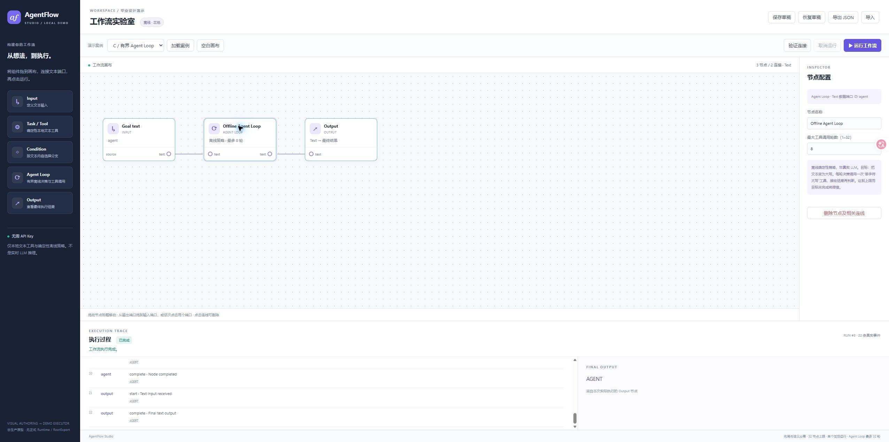

# 毕业设计阶段 2：AgentFlow Studio

已实现可操作的本地 Web 原型：五种节点、拖放画布、受约束 Text 端口连接、属性配置、节点/连线删除、浏览器草稿保存恢复、JSON 文本/文件导入导出、顺序/条件/有界离线 Agent 执行、取消与真实步骤日志。

实现提交：`0c876454b66ef97b3b2fe0976bea778d9baee993`。后续报告提交不改变该实现的 Rust、前端、Cargo 或资源策略输入。未 Push。

## 启动与使用

Linux 现有项目工作区：

```bash
ssh fwq
cd ~/projects/agent-r5g2-linux-validation/workspace
python3 -B tools/run-demo-gate.py serve
```

本地另开终端：

```bash
ssh -N -o ExitOnForwardFailure=yes -L 127.0.0.1:8787:127.0.0.1:8787 fwq
```

打开 http://127.0.0.1:8787 。已有演示会话时不要重复启动；受控服务有 90 分钟上限。启动 UUID 和回执在 `target/visual-workflow-demo/serve`，可用 `python3 -B tools/linux-demo-dev.py cancel --gate serve --id <UUID>` 正常停止。

拖入左侧组件，连接输出/输入圆点，点击节点编辑参数，然后运行。三个案例可从顶栏直接加载，也提供 `crates/af-demo/examples/*.json`。保存草稿使用浏览器 localStorage；跨浏览器/机器可复制导出 JSON，再粘贴到导入面板。

## 实际浏览器操作记录

- A：`Hello AgentFlow` → `HELLO AGENTFLOW`，6 条事件。
- B True：`Hello AgentFlow` → `Matched: Hello AgentFlow`；False：`hello offline` → `Not matched: hello offline`，各 9 条事件，未选择的 Task 没有执行记录。
- C：`agent` → `AGENT`，5 次工具调用、5 次反馈、6 次决策，共 22 条事件。最大轮数改成 1 时在 `agent` 节点明确失败；另一次运行通过取消按钮结束，状态为 cancelled，无成功输出。
- 从空白画布实际拖入 Input/Tool/Output，点击和拖拽两种方式连接、删除并重建连线、运行成功。重复占用端口被拒绝。
- 保存 → 清空 → 恢复 → 运行成功。导出面板的真实 JSON → 清空 → 导入文本 → 运行成功。
- 原生文件选择自动化被浏览器扩展的文件权限阻止，未修改浏览器安全设置。文件下载事件未被自动化工具确认；不把这两项计为浏览器自动测试通过。JSON 文本通道已实际验证，文件选择/下载入口保留供用户操作。



[案例 A 截图](screenshots/case-a.jpg) · [案例 B 截图](screenshots/case-b.jpg)

## 最终验证

四项均在同一干净实现 HEAD `0c876454b66ef97b3b2fe0976bea778d9baee993` 上实际执行并退出 0：

| 门禁 | 结果 | 耗时 |
| --- | --- | --- |
| `cargo fmt --all -- --check` | PASS | 2.23 秒 |
| `cargo clippy --locked --offline -j 1 --all-targets --all-features -- -D warnings` | PASS | 16.74 秒 |
| `cargo test --locked --offline --workspace -j 1` | PASS | 430.45 秒 |
| `cargo run --locked --offline -j 1 -p af-spec --bin spec-check -- check` | PASS | 12.64 秒 |

测试总计 **472 passed / 0 failed / 0 ignored / 0 filtered**：470 个原生测试 + 2 个 doctests，68 个原生目标和 16 个文档测试组。新增演示测试 24 项（20 项数据流/边界/序列化测试和 4 项真实 HTTP/子进程测试），没有使用测试过滤。spec-check：74 份规范、531 规则、530 已覆盖、1 项既有明确不覆盖、0 缺失覆盖；775 活跃 ABI、17 AFIDL 模块、0 交叉引用错误。

四项实际生效的选用限制为 CPU 在线容量 10%、AS 8 GiB、任务树 6 GiB、Swap 0、PIDs 128，其他阈值与批准范围一致；主机准入及清理均正常。最大观测 cgroup 内存 4,490,387,456 字节（约 4.18 GiB，包含缓存，不是单进程 RSS）；无 OOM、Swap 或 PIDs 耗尽事件。未额外安装依赖、提额或运行破坏性资格测试。

简洁机器汇总：`target/visual-workflow-demo/final-validation-summary.json`。四次执行冻结的 Rust/前端/Cargo 输入哈希全部一致，并与交付代码核对相同。

原始命令、退出码、日志哈希和必要资源回执保留在 `target/visual-workflow-demo`，不覆盖旧任务证据。两个浏览器测试服务通过正常受控取消停止，回收为空且删除所属 cgroup；该停止不是产品失败，也不伪造 Cargo 退出码。

## 架构与限制

新增 `af-demo` workspace crate。前端无 npm/CDN；服务端使用标准库 loopback HTTP、serde 和既有 `af-core` 整数校验。25 项第三方依赖与原锁定内容完全一致，Cargo.lock 只新增本地 crate。现有正式产品 crate、规范、Expected、Oracle、Registry 与历史冻结快照未改。

这是独立 Demo Workflow / ValidatedWorkflow / Demo Executor / Trace 链路，不是假冒的 Canonical Semantic IR 转换或正式 Runtime。离线 Agent 是确定性策略，绝非真实 LLM。没有任意 shell、凭据读取或网络工具，也没有 Durable Execution、Publication、RootExport 或多租户安全能力。

最多 32 节点、64 边；仅 Text 单路执行，只有 Output 可汇合分支，无并行 join。每个 Agent Loop 最多 32 轮，总声明调用预算 128；日志值为明确标记的 512 字符预览，最终输出保留完整文本（最多 16 KiB）。仅保存最近一次内存运行，重启不恢复执行。Windows 浏览器可经 SSH 使用；Windows 独立安装包尚未实现。

下一步最值得增加的是可选真实模型适配器及更贴近毕业设计场景的本地工具；凭据由用户自行提供，离线模式仍需保留。不会自动启动这些后续功能阶段。
