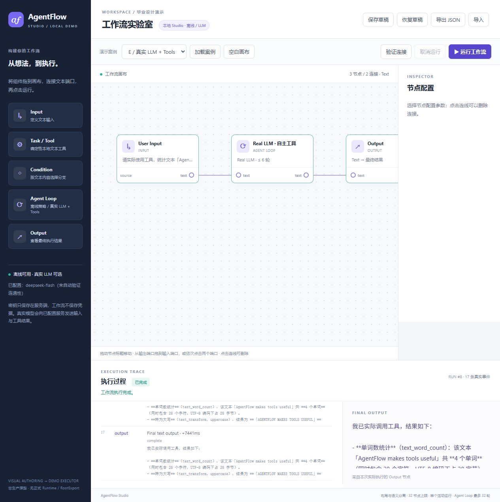

# 合并分叉与 Studio E2E 验证（2026-10-21）

验证基准提交：`b892fd93ead9008712e3c4639a7d776846b05481`。本目录只增加验证记录和截图，不改变 Rust、网页、依赖、正式规范或执行器输入。

## Git 合并与推送

Linux 分支 `codex/linux-primary-migration` 合并 Windows `master` 的 `56b033c818c21b9fd13f989ac7460d9056b7adb8`，保留原 Linux Studio HEAD `9949ce7b1c7e9200445151dc508d200d65785d5a`。合并没有冲突，相对原 Linux HEAD 只改变 `.gitignore`，也纳入 Windows 尚未推送的最后一条提交。

合并提交已通过普通快进推送更新 `origin/master`；没有强制推送或重写历史。Windows 的干净 `master` 已快进到合并结果。两端上游均为 `https://github.com/ymj68520/agentflow.git` 的 `origin/master`。交付文档提交将继续推送同一分支。

## 自动化检查

四项均在上述同一干净提交上实际运行，所有执行器输入哈希一致。详细 UUID、真实退出码、耗时、日志 SHA-256 和清理结果见 [gates.json](gates.json)。沿用既有项目 cgroup 执行器与数值上限，串行运行，不改系统设置或依赖。

| 检查 | 实际命令 | 结果 |
| --- | --- | --- |
| 格式 | `cargo fmt --all -- --check` | PASS，退出 0 |
| Clippy | `cargo clippy --locked --offline -j 1 --all-targets --all-features -- -D warnings` | PASS，退出 0 |
| 全量测试 | `cargo test --locked --offline --workspace -j 1` | 496 passed / 0 failed / 0 ignored / 0 filtered |
| 规范 | `cargo run --locked --offline -j 1 -p af-spec --bin spec-check -- check` | PASS，退出 0 |

全量测试含 Studio 的 48 项测试（HTTP 5、模型/工具/传输 23、工作流 20），覆盖真实二进制 HTTP、两条条件路径、工具消息协议、预算、未知/未允许工具、参数批次校验、超时、取消、凭据脱敏和输入边界。测试中的本地协议 Fixture 使用合成凭据，与下述真实外部模型调用分开记账。

spec-check：74 份规范、531 条规则、530 条已覆盖、1 条既有明确不覆盖、0 缺失覆盖；775 个活跃 ABI、17 个 AFIDL 模块、0 交叉引用错误。

## 浏览器 E2E

使用独立的 Codex 内置浏览器，通过既有 SSH 回环转发访问 `http://localhost:8787/`。服务从上述合并提交经受控 `serve` 门禁启动，配置路径由服务端加载；凭据不进入浏览器或工作流。15 项浏览器检查全部通过，控制台没有 warning/error；原始可见状态见 [browser-e2e.json](browser-e2e.json)。

| 场景 | 实际结果 |
| --- | --- |
| A 顺序处理 | `Hello AgentFlow` → `HELLO AGENTFLOW` |
| B True | 选择 True，仅执行 Task A，输出 `Matched: Hello AgentFlow` |
| B False | 编辑输入为 `offline`，仅执行 Task B，输出 `Not matched: offline` |
| 草稿 | 保存 → 空白画布 → 恢复，5 节点、5 连接及修改后的输入保留 |
| JSON 文件 | 实际点击下载，经文件选择器导入同一文件，工作流与布局逐字段一致 |
| C 离线循环 | 5 次工具调用/反馈后输出 `AGENT`，不是 LLM |
| C 上限 | 最大轮数改为 1 后明确失败，没有成功 Output |
| 离线取消 | 32 字符输入运行中点击取消，状态 cancelled，没有成功 Output |
| D 真实问答 | `deepseek-flash` 实际返回中文回答，9 个事件 |
| E 真实工具 | 2 个模型请求、2 次模型自主工具调用、17 个事件；真实结果为 4 个单词和大写文本 |
| 非法图 | 新建未连线的图被服务端拒绝 |
| 空白建图 | 添加 Input/Task/Output，拖开节点，点击端口连接，再验证和运行，输出 `HELLO AGENTFLOW` |
| 凭据字段拒绝 | JSON 导入含合成 `api_key` 字段时被拒绝；未使用真实密钥测试该输入 |
| Find 白名单 | 仅允许 `text.find`，真实模型调用查找 `猫a猫` 中的 `猫`；字符索引 0/2，UTF-8 字节偏移 0/4 |
| 真实请求取消 | 观察到 Model Request 后点击取消，523 ms 时记录传输已回收；无成功输出或后续工具调用 |

只点击组件列表添加节点时，初始布局相邻节点会重叠；本轮按界面操作拖开后连接端口，拖动和连线均成功。没有把遮挡状态下未命中端口的点击记作成功连线。

真实模型原始事件分别见 [D](real-qa-run.json)、[E](real-tools-run.json)、[Find](real-find-run.json) 和 [取消](real-cancel-run.json)。E 的工具实际返回：

```json
{"character_count":28,"utf8_bytes":28,"word_count":4}
{"operation":"uppercase","text":"AGENTFLOW MAKES TOOLS USEFUL"}
```



其它截图：[问答](screenshots/real-qa.jpg)、[Unicode Find](screenshots/real-find.jpg)、[空白建图](screenshots/custom-graph.jpg)、[真实请求取消](screenshots/real-cancel.jpg)。

## 凭据与资源收尾

推送前扫描了待推送历史中的 216 个新增 blob（3,390,661 字节），未发现服务端已配置的真实 API key。文档和截图再次按实际 key 检查后提交；真实凭据仍仅位于忽略的 `target/private/model.json`。

E2E 完成后正常停止本轮服务，未保留后台演示进程；[service-cleanup.json](service-cleanup.json) 记录 cgroup 为空且已移除、OOM kill 为 0。服务停止产生的 `UserCancelled` 是主动测试收尾，不记作产品测试失败。真实 API 取消只确认本地传输回收，不能断言第三方同步停止推理或计费。

本轮验证范围是现有 Studio 演示链路，并未授予正式 Semantic Runtime、RootExport、持久化/分布式执行或 Windows 可执行程序验收。Windows 本轮只同步 Git 源码，Rust 验证全部在 Linux 执行。
