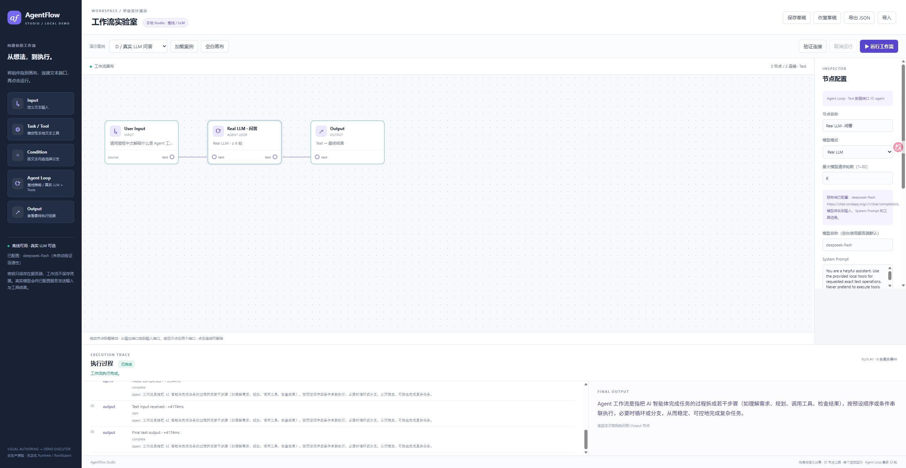
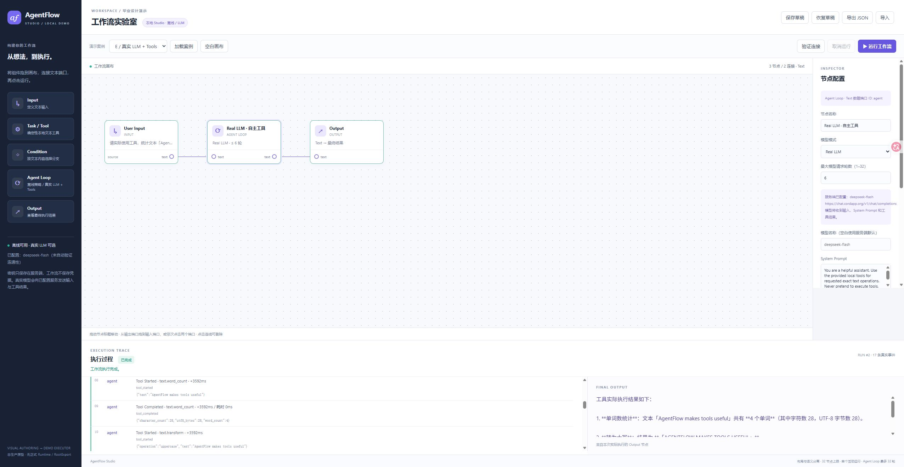

# AgentFlow Studio 阶段 3 交付

实现提交：`e0b1d8a845fb8ef7e6a7c1c819d47f923f42fa84`。完整配置说明位于 `crates/af-demo/README-models.md`，下文另附启动命令。本报告及截图提交仅补充文档，不改变实现输入。

## 实际实现

新增可替换 `ModelAdapter`、OpenAI-compatible Chat Completions 适配器、有界模型驱动工具循环、3 个本地安全工具和 D/E 两个可加载案例。继续使用已有五种节点；Agent 可选择离线或 Real LLM，配置模型、System Prompt、请求次数、工具预算、超时与允许工具。布局和语义分离，旧 v1 离线工作流保持兼容。

真实调用只执行响应中的标准 `tool_calls`；名称与参数来自模型，不从自然语言猜测，也不预排函数序列。整批先校验白名单、参数、ID、预算，再执行本地函数并以对应 `tool_call_id` 回传结果。Trace 明确区分模型请求/响应、工具请求/开始/完成、模型最终回答，并显示真实耗时。

保持项目本地 cgroup 保护和既有资源上限，没有安装软件、增加 Cargo 依赖、修改系统设置、正式规范、Expected、Oracle、Registry 或冻结历史快照。普通 lint 已修复，保留首次 Clippy Exit 101。浏览器回归发现并修复了空闲预连接被错误返回 HTTP 超时的问题，新增真实二进制回归测试。

## 真实 API 与浏览器验证

使用用户指定的 `https://chat.cordapp.org/v1/chat/completions`、请求模型 `deepseek-flash`，凭据仅服务端配置。**以下真实 API 记录与本地 Fixture 分开记账。**

- D：实际模型问答完成，界面显示 Model Request → Model Response → Model Final Answer → Output；首轮模型请求耗时 4472 ms。
- E：实际模型自主返回 Word Count 和 Text Transform 两个标准调用。实际函数返回 `{word_count:4, character_count:28, utf8_bytes:28}` 和 `AGENTFLOW MAKES TOOLS USEFUL`；真实模型接收结果后给出最终回答。首轮共 2 个模型请求、2 次工具调用、17 个事件。
- 自定义 Agent：从 Offline 切换为 Real LLM，编辑 System Prompt、预算与工具白名单，只允许 `text.find`。模型实际查找 `猫a猫` 中的 `猫`，函数返回字符索引 `0,2`、字节偏移 `0,4`，再由模型解释。
- 真实网络请求开始后点击取消，界面确认 cancelled，无成功输出；本地 curl 传输回收。不能保证第三方同步停止推理/计费。
- A/B/C 在新界面实际重跑，分别得到 `HELLO AGENTFLOW`、`Matched: Hello AgentFlow`、`AGENT`；旧条件 False 路径保留并由回归测试覆盖。
- Real 配置已实际保存 → 清空 → 恢复 → JSON 导出/导入，公开模型参数及仅允许 Find 的设置保持。导入工作流中的 `api_key` 字段被拒绝，没有写入画布或草稿。
- 浏览器测试使用独立 localhost 存储域，不覆盖原 127.0.0.1 草稿；切换前已备份用户正在编辑的画布到本地忽略目录。JSON 文本通道已测试；原生文件选择/下载仍沿用阶段 2 入口，本阶段不宣称完成其自动化覆盖。





## 质量检查

四项均在上述同一干净实现 HEAD 上实际运行并退出 0：

| 门禁 | 结果 | 耗时 |
| --- | --- | --- |
| `cargo fmt --all -- --check` | PASS | 2.23 s |
| `cargo clippy --locked --offline -j 1 --all-targets --all-features -- -D warnings` | PASS | 15.84 s |
| `cargo test --locked --offline --workspace -j 1` | PASS | 433.93 s |
| `cargo run --locked --offline -j 1 -p af-spec --bin spec-check -- check` | PASS | 12.76 s |

全量 **496 passed / 0 failed / 0 ignored / 0 filtered**：494 个原生测试、2 个 doctests；69 个原生目标、16 个文档测试组。演示相关 48 项，其中 24 项为本阶段新增，原有测试未删减或过滤。spec-check：74 份规范、531 规则、530 覆盖、1 项既有明确不覆盖、0 缺失覆盖，775 活跃 ABI、17 AFIDL 模块、0 交叉引用错误。

四次冻结的构建输入哈希全部相同。资源上限实际回读正确；各门禁均正常清理，无 OOM/Swap/PIDs 耗尽异常，最大观测 cgroup 内存为 4,493,606,912 字节（约 4.18 GiB，包含缓存，不是单进程 RSS）。机器汇总：`target/studio-model-dev/final-results.json`。Cargo.lock 及 25 项既有锁定依赖未变。

本地 Fixture 使用合成凭据与 loopback HTTP，验证标准消息回传、工具选择、未知/未允许工具、非法参数、预算、重复 ID、迭代上限、错误 HTTP/JSON、超大响应、超时、取消、凭据脱敏（包括 JSON 转义与预览截断边界），不作为真实模型调用证明。

原始退出码、日志与必要资源回执在 `target/studio-model-dev`。首轮 E、Find、真实取消分别保存为 `real-tool-calling-first.json`、`real-find.json`、`real-model-cancel.json`。所有旧失败回执保留；没有过滤、删除测试或降低 Clippy 标准。

## 配置、启动、限制

```bash
ssh fwq
cd ~/projects/agent-r5g2-linux-validation/workspace
# 已配置则跳过；密钥在交互提示中输入，不进入 shell 参数
python3 -B tools/configure-demo-model.py
python3 -B tools/run-model-demo-gate.py serve
```

另开本地终端 `ssh -N -L 127.0.0.1:8787:127.0.0.1:8787 fwq`，打开 http://127.0.0.1:8787 或 http://localhost:8787 。已有会话先用 `python3 -B tools/linux-model-demo-dev.py cancel --gate serve --id <UUID>` 正常停止，不重复启动。

凭据文件为忽略的 `target/private/model.json`，权限 0600；服务器环境只传配置路径，不传或记录密钥。密钥不进入 argv、工作流、localStorage、Git 或应用 Trace；已知凭据先脱敏再作日志预览。第三方 HTTP 错误正文和 Authorization 头不写 Trace。不跟随重定向、不关闭 TLS 校验、无任意 shell/磁盘/网络工具。因为密钥曾出现在聊天中，建议用户轮换并用 `--replace` 重新配置、重启。

这仍是可信本地演示原型，不是正式 Semantic Runtime、RootExport、Publication、持久化/分布式执行或生产安全沙箱。只保存最近一次内存运行，无 Windows 安装包。下一步适合增加安全的结果展示与流式响应体验，不自动启动新产品阶段。未 Push。
